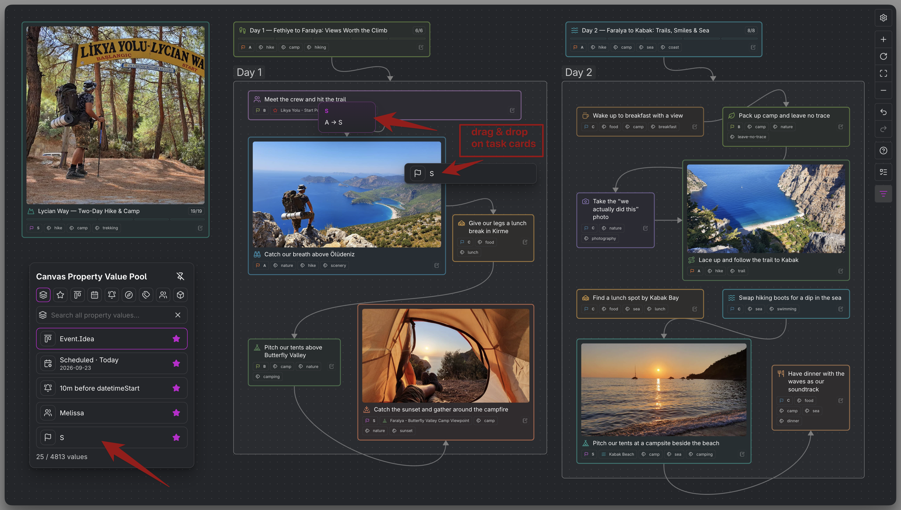

# Property Value Pool for Canvas, Excalidraw, and Kanban

Property Value Pool finds reusable values to apply to task cards on Canvas, Excalidraw, and Kanban. Use it to apply a status, priority, tag, or another supported value to an existing task. [[DOCS-148 Canvas and Excalidraw Task Pool|Task Pool]] adds existing tasks to the board; Property Value Pool changes their properties.

## Open the pool

Open the pool from the active view's controls. In Kanban, **Kanban Property Pool** is on the right edge of the board. Canvas and Excalidraw also offer commands:

| Surface | Command |
| --- | --- |
| Canvas | **Operon: Open Canvas Property Value Pool** |
| Excalidraw | **Operon: Open Excalidraw Property Pool** |

The corresponding view must be active. The panel opens on its first visible shortcut. In Excalidraw, it follows the drawing's light or dark appearance. Canvas, Excalidraw, and Kanban share favorites, shortcut preferences, and panel size settings.

## Search and favorite values

Choose **All values**, **Favorites**, or a property shortcut. All values searches supported fields together; a property shortcut narrows the search. To search within a property using the keyboard:

1. Choose **All values** and type at least two characters of the property's name, for example `st` for Status. Matching property suggestions appear before value results. Names follow your key mappings.
2. Use `Up` or `Down` to select the property suggestion, then press `Enter`. This opens that property's search scope and clears the query. Typing two characters alone does not switch scopes.
3. Type the value you want to find within that property.

Among value results, matching favorites come first. In All values and Favorites, properties follow your configured shortcut order, including hidden shortcuts; unassigned properties follow the standard order. Dates gives date fields a shared position, with the first occurrence winning when individual date shortcuts also exist. Unavailable favorites follow usable results and can still be removed.

Use a row's star to add or remove a favorite. Favorites are shared across Canvas, Excalidraw, and Kanban in the vault. Switching shortcuts preserves your query; Clear returns to the first visible shortcut.

## Apply a value to a task

Drag a value onto an Operon task card and inspect the change preview before releasing. On a touch screen, press and hold the row before dragging. An ordinary swipe scrolls results.

Single-value properties replace the existing value. List properties append missing items without duplicates:

```text
Priority: C → A
Tags: planning → planning; launch
```

> **MEDIA-DOCS-145-1:** Dragging the launch tag from Canvas Property Value Pool onto a task card, with the preview showing it added to the existing planning tag.



Drops update the source task, so its other cards and views reflect the change. Changing a File Task's status follows its configured pipeline folder rules. Editing an unrelated field does not by itself relocate a manually placed File Task to a pipeline folder.

### Apply a value in Kanban

Drop the value onto **one task card** in the same board. Dropping into empty cell space leaves the tasks in that cell unchanged. If the preview blocks a change and directs you to Task Editor, finish the change there.

You can change a field used for a column or swimlane. The board places the card according to its updated values and sorting rules. The drop edits the selected field without reapplying the old cell's rules or setting a manual insertion position. For example, adding Miro to an assignee list can show the same task in Miro's group while it remains in groups for its existing assignees.

The pool stays open after a successful drop and keeps your search and selected property. If the updated task does not match the board's saved filter, Operon keeps the change, shows a warning, and opens Task Editor.

### Undo and task changes

On Canvas, Undo/Redo includes related changes recorded with the drop, including supported pipeline folder moves. Later task changes may prevent replay.

Excalidraw Undo affects the drawing scene. Kanban has no Undo/Redo for these drops. To revert a source property change on either surface, edit the task in [[DOCS-021 Task Editor|Task Editor]].

### Use values with Canvas groups

Supported values can also create Canvas groups or extend a matching list group's rule. Changing that rule does not bulk-update the tasks inside the group. See [[DOCS-146 Operon Groups in Canvas|Operon Groups in Canvas]].

## Dates, reminders, and media

Dates offers relative choices such as Tomorrow. A favorite retains the relative rule, and the displayed date updates as time passes. Scheduled changes follow existing Daily and Weekly Notes parent rules when applicable.

Reminder rules append to the task with a reminder-time preview. Missing reference dates or reminders that would already be past prevent the drop. Links, task images, and gallery items reuse existing references; gallery additions preserve their order.

The pool reuses configured or existing values and supported date/reminder choices; it does not create arbitrary values.

## Use the keyboard and arrange the panel

While the search box has focus, use `Up` and `Down` to select results. To move through the property shortcuts above it:

1. Move to the first result, then press `Up` again to focus the active shortcut above the search box.
2. Use `Left` and `Right` to switch between available shortcuts. The results change with the selected shortcut, and your search text is preserved.
3. Press `Down` to return to the search box and continue typing. `Enter` or `Space` on a shortcut also selects it and returns to search.

With an empty search box, `Left` and `Right` switch shortcuts directly without moving focus out of search. `Enter` on a selected value toggles its favorite; on a property suggestion it opens that property's scope. `Escape` closes the panel.

In the separate **Create group** context, `Enter` creates the group instead of changing favorites.

Drag the header to move the panel. Pin it to keep it open when clicking elsewhere; an unpinned panel closes on an outside click. When both panels are open, interacting with one brings it forward. In Kanban, pin both pools to keep them open together. Opening the other pool can close an unpinned panel.

## Tips

> [!tip] Keep frequent values close while planning
> Favorite the statuses, priorities, and tags you use most, then pin the pool beside your board or drawing. You can apply them to task cards without repeating the same searches.

## FAQ

**Why does Enter not change the task?** In normal pool use it manages favorites. Drag a value onto the task to apply it.

**Why is a drop unavailable?** Check the preview, write access to the board or drawing, the target card, and whether the value still exists. In Excalidraw, the target card must also be unlocked and unobstructed by another element. Some changes need additional task workflows; when the preview asks you to use [[DOCS-021 Task Editor|Task Editor]], complete the change there.

**Are searches limited to visible rows?** No. Search covers matching values; scrolling loads more results.

## Settings

Open **Settings → Operon → Views → Task Cards**. Three separate sections control this pool: `Canvas, Excalidraw and Kanban Property Pool` for size, `Property Pool Shortcuts` for shortcut visibility and order, and `Property Pool Favorites` for managing saved values.

`Property Pool Shortcuts` provides nine slots with visibility and ordering controls. Initially all are enabled: All values, Favorites, Status, Dates, ReminderRules, Contexts, Tags, Assignees, and Type. Property shortcuts retain their canonical identities but display your [[DOCS-039 Key mappings|mapped property names]]; a context mapping named Up appears as Up.

Under `Canvas, Excalidraw and Kanban Property Pool`, `Panel width` offers 240, 280, 320, 360, or 400 px, constrained by available space. `Visible rows` offers 5, 7, 11, or 13. Defaults are 320 px and 5 rows.

`Property Pool Favorites` lists saved property values and lets you remove them from favorites. These are shared across Canvas, Excalidraw, and Kanban in the vault; removing a favorite does not remove that value from tasks.

## Related

- [[DOCS-001 Operon Docs MOC|Operon Docs MOC]]
- [[DOCS-147 Excalidraw Task Cards|Excalidraw Task Cards]]
- [[DOCS-148 Canvas and Excalidraw Task Pool|Canvas and Excalidraw Task Pool]]
- [[DOCS-141 Canvas Task Cards|Canvas Task Cards]]
- [[DOCS-146 Operon Groups in Canvas|Operon Groups in Canvas]]
- [[DOCS-062 Field pickers overview|Field pickers overview]]
- [[DOCS-063 Date and time picker|Date and time picker]]
- [[DOCS-117 Reminder rules|Reminder rules]]
- [[DOCS-138 Task images and galleries|Task images and galleries]]
