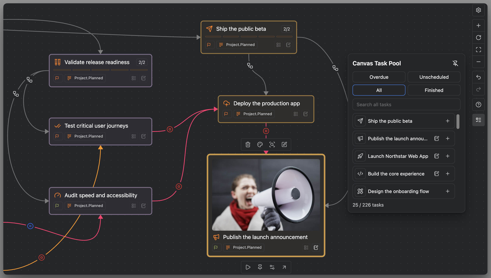

# Task Pool for Canvas, Excalidraw, and Kanban

Task Pool is a searchable list of existing Operon tasks for building a visual plan. Use it to gather existing tasks from your notes, place linked cards on Canvas or Excalidraw, or put tasks in a Kanban cell.

Canvas, Excalidraw, and Kanban share the same search, task modes, and panel size preferences. Each open pool belongs to the view where you opened it. For card editing and relationships, see [[DOCS-141 Canvas Task Cards|Canvas Task Cards]] or [[DOCS-147 Excalidraw Task Cards|Excalidraw Task Cards]].

## Open Task Pool

Use the Task Pool button in the active view. In Kanban, **Kanban Task Pool** is on the right edge of the board beside the other floating controls. Canvas and Excalidraw also offer commands:

| Surface | Command |
| --- | --- |
| Canvas | **Operon: Open Canvas Task Pool** |
| Excalidraw | **Operon: Open Excalidraw Task Pool** |

The corresponding view must be active. Excalidraw also requires the Excalidraw plugin and its supported integration APIs. The panel follows the drawing's light or dark appearance.

The pool starts in `All` with an empty search each time it opens. You can browse available tasks, but adding cards or changing tasks requires a writable surface.

## Choose which tasks to show

The five mode buttons appear in this order: **Overdue → Unscheduled → All → Finished → Pinned**. Hover over a button for its name.

| Mode | Tasks included |
| --- | --- |
| Overdue | Open tasks with a Scheduled or Due date before today |
| Unscheduled | Open tasks without a Scheduled date |
| All | All open tasks |
| Finished | Completed tasks, including those completed on earlier days |
| Pinned | Pinned tasks in any status, including completed and cancelled tasks |

The pool searches existing tasks using its own modes and query. In Kanban, it can find tasks that are outside the board filter. Search narrows the selected mode across its matching tasks, not just the rows currently displayed. More results load as you scroll, and task changes refresh the results.

Changing the mode or query does not remove cards already placed on the board. The results are available tasks from your notes, not an inventory limited to this drawing.

## Add a card on Canvas or Excalidraw

Use whichever method fits how you are arranging the plan:

- Click a row's **+** button to add its task, then position the new card.
- With a mouse, drag a task row onto the desired position in the board or drawing.
- With the search box focused, use `Up` and `Down` to select a result, then press `Enter` to add it.
- On a touch screen, use **+**, then arrange the card on the surface.

In all three views, click the task title to open the task. The row's task icon and Note control provide their own task actions when available.

Adding a card does not move the task's Markdown source, change its parent or dates, or create another task. The card refers to the existing task identity. You can show that task on more than one board and keep working with the same source task.

## Place an existing task in a Kanban cell

Drag a task row onto an expanded cell in the same board. On a touch screen, press and hold the row before dragging. You can drop into an empty cell or over a card in the target cell. Kanban placement uses dragging, with no **+** button or **Enter** action.

Check the preview before releasing. It shows which fields will change or tells you when a target is blocked. The cell's column and swimlane values apply together to the existing task. A single-value field takes the target value. A list field keeps its current values and adds any missing target value. For example, a **Priority A × Assignee Miro** cell sets Priority to A and adds Miro to the assignees. The task can still appear in its previous cell if it still matches that cell.

In a Manual cell, the insertion indicator shows where the card will go. You can also reorder a task already in that cell, even when there are no field changes. An Automatic cell follows its sorting rules. See [[DOCS-031 Kanban manual order|Kanban manual order]].

If the updated task does not match the board's saved filter, Operon keeps the change, shows a warning, and opens Task Editor. Placing a task never changes extra fields to make it pass the filter. Cancelled or invalid drops leave the task unchanged.

## Keep the pool beside your work

Drag the header to move the panel. Moving it also pins the panel open. You can instead choose **Pin Task Pool** before adding several cards.

Panel pinning is separate from the `Pinned` task mode. The panel pin keeps the pool open; the mode shows tasks pinned in Operon.

An unpinned pool closes after a successful placement or an outside click. A pinned pool stays open as you add cards and work elsewhere on the surface. Choose **Unpin and close** or press `Escape` to close it. When both panels are open, interacting with one brings it forward. In Kanban, pin both pools to keep them open together. Opening the other pool can close an unpinned panel.

## Plan a project on Canvas or Excalidraw

For a web app launch, start with **Launch Northstar Web App** and arrange four workstreams: product definition, core development, release validation, and the public beta.

1. **Pin Task Pool** and move it to a free edge of the board.
2. **Find the relevant work.** Search in `All` for launch tasks already in your notes. Use `Unscheduled` for work without a scheduled date, or `Overdue` to review what has slipped.
3. **Add cards in context.** Drag tasks near the workstream they belong to, or use **+** and arrange them afterward. Placement alone does not assign a parent or schedule.
4. **Set the relationships deliberately.** Connect cards, then use that surface's relationship controls for parent/child or blocking relationships. The card guides explain those controls.
5. **Review what is done.** Switch to `Finished` when completed tasks help explain the plan's progress.

You can gather tasks in several passes without losing the arrangement. Use [[DOCS-028 Calendar overview|Calendar]] to place the work in time or [[DOCS-139 Gantt view|Gantt]] to review dates and dependencies along a timeline.

> **MEDIA-DOCS-148-1:** Canvas Task Pool open beside the Northstar launch plan, showing mode controls, search, and task rows ready to add to the project's workstreams.

## Tips

> [!tip] Choose the pool for the action
> Task Pool adds cards for existing tasks. [[DOCS-145 Canvas and Excalidraw Property Value Pool|Property Value Pool]] applies reusable values to tasks already on the surface. To create a new task, use Task Creator or the creation controls described in the relevant card guide.

## FAQ

**Does the pool create new tasks?** No. It adds cards for tasks that already exist. Use [[DOCS-020 Task Creator|Task Creator]] to create a task.

**Why is a task missing from the results?** Check the selected mode and search text first. Completed tasks belong in `Finished`, while `Pinned` can include pinned tasks in any status. If the task is still missing, see [[DOCS-054 Missing tasks|Missing tasks]].

**Why can I not add a card?** Check that the target board or drawing is writable and that the task can be resolved uniquely. Missing or duplicate identities must be resolved before adding the card. See [[DOCS-055 Duplicate IDs|Duplicate IDs]].

**Does changing the pool's size resize my cards?** No. Pool dimensions control the floating list. Card widths have separate settings for Canvas, Excalidraw, and note embeds.

## Settings

Open **Settings → Operon → Views → Task Cards → Canvas, Excalidraw and Kanban Task Pool**. These preferences apply to all three views.

| Setting | Choices and behavior |
| --- | --- |
| `Panel width` | 240, 280, 320, 360, or 400 px; default 320 px, constrained by the available space |
| `Visible rows` | 5, 7, 11, or 13; default 5. This controls the panel height, not the number of searchable tasks |

Use **Pin Task Pool** on the panel to keep it open during a planning session.

## Related

- [[DOCS-001 Operon Docs MOC|Operon Docs MOC]]
- [[DOCS-141 Canvas Task Cards|Canvas Task Cards]]
- [[DOCS-147 Excalidraw Task Cards|Excalidraw Task Cards]]
- [[DOCS-027 Task Finder|Task Finder]]
- [[DOCS-020 Task Creator|Task Creator]]
- [[DOCS-095 Calendar Task Pool|Calendar Task Pool]]
