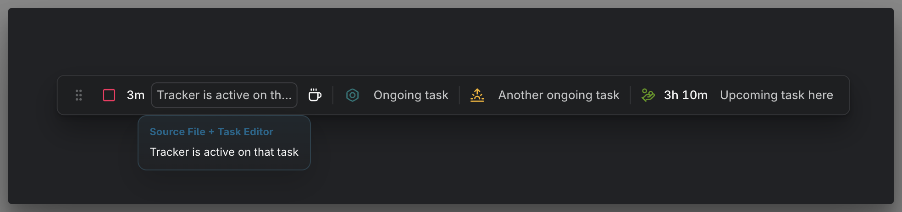
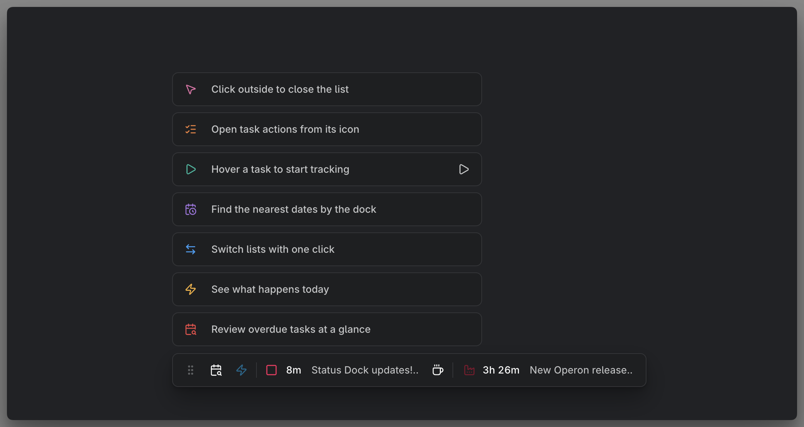

# Status Dock

The **Status Dock** brings time tracking, calendar tasks, task lists, session history, and duplicate-ID warnings into one desktop bar. It stays available while you work in ordinary Obsidian tabs, including Markdown notes. Use it to check what needs attention, pick up recent work, or review a saved session.

> **MEDIA-DOCS-152-1:** The desktop Status Dock with an assigned running timer, Coffee, two ongoing calendar tasks, and the next upcoming task with its countdown. Show the six-dot drag handle and hover over one calendar task so its icon becomes Play. Keep task names readable; ongoing tasks should have no visible Now label or zero countdown.

## Show, hide, and position the dock

The dock starts visible near the bottom center of each desktop window with a main workspace tab. It is positioned within the window viewport, so scrolling a note does not move it. It is not inserted into sidebars or lightbox content; opening a lightbox does not remove the dock behind it.

Drag the **six-dot handle** to move it. With the handle focused, arrow keys move it and **Home** resets its position. The dock stays within the available window bounds. Position is temporary: restarting Obsidian restores the centered default.

Run **Operon: Toggle status dock** from the command palette to hide or show it across windows. This changes visibility only; it does not stop a timer or end a break. There is no separate Settings visibility switch. Restarting Obsidian makes the dock visible again.

In a narrow window, controls can wrap to a second row. The Status Dock is desktop-only. See [[DOCS-140 Upcoming Tasks|Upcoming Tasks]] for the mobile Status Bar.

## Choose and arrange sections

Open **Settings → Operon → Interface → Workspace Tweaks → Status Dock → Sections and Order**. Turn each section on or off and use the arrows to move it. The settings list runs from top to bottom in the same order that the Dock runs from left to right. All seven sections start enabled.

| Default position | Section | What it shows |
| --- | --- | --- |
| 1 | Overdue & Happens Today | Two task lists with a shared visibility setting |
| 2 | Time Tracker | Timer, break, Task Finder, and Task Creator controls |
| 3 | Ongoing Tasks | Timed calendar tasks in progress, or the retained task after its countdown ends |
| 4 | Upcoming Tasks | The next future timed task |
| 5 | Pinned Tasks | Tasks in your active pinned group |
| 6 | Modified Tasks | Recently modified tasks |
| 7 | Session History | Recently recorded time sessions |

An empty list hides its icon. Hiding Time Tracker leaves any running timer or break active. The drag handle and duplicate-ID warnings sit outside the section order. Use the command palette toggle to control visibility of the whole Dock.

## Track time and take a break

The tracking section contains **Play or Stop**, the timer, the task name, and controls appropriate to the current state. These controls do not automatically open the FlowTime panel.

| State | Available actions |
|---|---|
| No timer and no waiting task | Play starts an unassigned timer. Task Finder and Task Creator let you choose or create a task to track. |
| An unassigned timer is running | Stop ends the timer. Task Finder and Task Creator let you attach a task through the tracking flow. |
| A task is being tracked | Stop finishes and saves the work session. Coffee records the current work session and starts a break without opening FlowTime. |
| A break is active | Play starts a new work session for the waiting task. Coffee ends the break without restarting work. Finder and Creator let you start a different task instead. |
| A break has ended and a task is waiting | Play resumes that task in a new session. Finder and Creator let you choose a different task. |

The Task Finder tooltip is **Track a different task**. Task Creator uses **Create a new task and start tracking**. During a break, successfully choosing or creating a task ends the break and starts tracking that task; cancelling the picker or Creator leaves the current state in place.

The dock and [[DOCS-035 FlowTime focus sessions|FlowTime]] share the same break. Closing the FlowTime panel does not end it. Restarting Obsidian or reloading Operon clears the temporary break and waiting task, while saved work sessions remain recorded. Existing FlowTime break duration and notification preferences apply.

Controls respond immediately while session saving completes. A failed save does not count as a successfully recorded session or completed break transition. See [[DOCS-034 Time tracking|Time tracking]] for recorded sessions and history.

## Read the timer

Durations below one minute show seconds, such as **29s**. Longer durations use minutes, such as **41m** or **2h 34m**. The next-task countdown uses the same compact format. The dock does not change duration formatting in other views.

An idle or waiting timer has no **0s** label. Without an assigned task, **Track time** or **Select or create a new task** is plain text. Use the Finder or Creator icon beside it. The timer and countdown values in the bar do not open a task or show its opening tooltip. The separate recent-session card has a clickable duration, described below.

## Overdue and Happens Today lists

Two icons in the **Overdue & Happens Today** section open task lists using the same scopes as [[DOCS-027 Task Finder|Task Finder]]:

| List | Open tasks included |
|---|---|
| **Overdue** — calendar-search icon | Scheduled or due before today. |
| **Happens Today** — lightning icon | Due, scheduled, or started today. |

These lists use indexed tasks across the vault, independently of the filter in your current view. Dates follow your local day. A task appears once within each list; it can qualify for both lists. Each icon appears only when its scope contains tasks. When both scopes are empty, their separator also disappears.

> **MEDIA-DOCS-152-2:** The Status Dock with Happens Today selected, showing its task cards stacked above the dock and the active lightning icon.

Cards in these two lists are ordered with the nearest qualifying date or time closest to the Dock.

## Pinned Tasks and Modified Tasks

- **Pinned Tasks** shows the active pinned group using its saved order. The first task in that order sits closest to the Dock. Manage pinning and sorting in the existing [[DOCS-032 Pinned Task Dock|Pinned Tasks]] surfaces.
- **Modified Tasks** uses Task Finder's **Recently modified window** setting. The newest change sits closest to the Dock. The list can include inline and file tasks in any status, including completed and cancelled tasks. See [[DOCS-027 Task Finder|Task Finder]].

## Use the Dock lists

Click a list icon to open it, click it again to close it, or click another list icon to switch. One list is open per window. Cards can stack above or below the Dock, with the first result closest to it in either direction. The visible area fits up to **ten complete cards**, or fewer in a shorter window. Scroll to reach the remaining entries.

Task-list cards show the task icon and description and stay open until dismissed. Session History cards also show a duration. They share the recent-session card's height and fixed width, constrained by the available window space. Short names do not shrink the card; longer names use the available space before ending in an ellipsis.

- **Task icon:** clicking follows the global **Task icon click action** preference. Hovering opens the task's contextual menu.
- **Task description:** clicking follows the Status Dock's source/editor opening preference below.
- **Play/Stop:** hovering over a card reveals this action at its right edge. Its border appears when the control itself is hovered or focused. It starts or stops that task's timer without closing the list. There is no inline Unpin button.

Click outside the list or elsewhere on the dock bar to close it. A dock action still runs normally after closing the list. Menus and editors opened from a card remain usable without being treated as an outside click. With focus in the dock or list, **Escape** closes the list once its own popup has been dismissed. The list also closes if you change the section order, hide its section or the Dock, or its scope becomes empty. Dragging the handle keeps the list open as it follows the Dock. Pressing **Escape** during a drag restores the original position and leaves the list open.

Configure the cards' hover-menu actions in **Interface → Context Menu → Action Visibility by Surface → Task Lists → Status Dock**. This setting controls menu actions. Manage list visibility through **Sections and Order**. See [[DOCS-042 Contextual menu actions|Contextual menu actions]].

## Browse Session History

Click the **Session History** icon to see recorded sessions within the **History window (days)** configured under **Tasks → Tracker → Session History**. The list follows the history panel's order by session start, with the newest session closest to the Dock. Each session has its own card, so the same task can appear more than once.

Each card shows the task icon, session duration, and task description. Click the duration to open **Edit session**, or the description to open the task using the Dock's **Click behavior**. Use **Start Timer** to begin a new session for that task. See [[DOCS-053 Time session history|Time session history]].

## Review the latest saved session

While the dock is visible, a newly saved task session shows a temporary card beside it. This includes stopping a task timer from another surface, starting a break with Coffee, or adding a session manually. Editing or deleting an existing session does not create a new card, and stopping an unassigned timer does not produce a task-session card.

The card contains the task icon, its recorded duration with seconds, such as **34m 22s**, and the task description:

- Click the **duration** to open **Edit session** for that saved record.
- Click the **description** to use the Status Dock's source/editor opening preference.
- Click or hover over the **task icon** to use the same icon action and contextual menu as the dock's task-list cards.

The card disappears after **ten seconds** of active display time. The countdown pauses while the pointer is over it, it has keyboard focus, or its task menu or an action is in use. It also pauses while the window's document is hidden.

Only the latest saved session is shown. If a Dock list is open, the session card waits until the list closes. The temporary card is available even when the Session History section is off. Clicking the dock's Stop or Coffee control closes the list and lets the newly saved session appear. Hiding the dock dismisses these temporary cards without changing saved sessions.

The card aligns with the dock's left edge and adapts to available space. For other ways to correct a session, see [[DOCS-053 Time session history|Time session history]].

## Current and upcoming tasks

The **Ongoing Tasks** and **Upcoming Tasks** sections follow the eligible tasks and planning rules described in [[DOCS-140 Upcoming Tasks|Upcoming Tasks]]. It is separate from the task you are actively tracking: being scheduled now does not start a timer automatically.

- Multiple ongoing timed tasks appear together, with the earliest start on the left. Finished tasks are excluded.
- Ongoing tasks show their names without a zero countdown or a visible **Now:** prefix. When no timed calendar task is ongoing, this section can show the retained task whose countdown ended.
- **Upcoming Tasks** shows the next future timed task with its countdown, even if **Ongoing Tasks** is off. All-day entries do not become timed countdowns.
- When a countdown reaches zero, the current task can remain alongside the next future task. There is no desktop **When countdown ends** selector.

Each task uses its own icon when configured. Otherwise the current-task icon falls back to the **Scheduled** key-mapping icon, and the upcoming-task icon to the **Due** key-mapping icon. This icon fallback does not turn the upcoming selection into a due-date query. Icon color uses the task color, with the theme accent as fallback.

Hover over a calendar task to reveal **Play** in place of its icon. Click that icon to start tracking the task, including an upcoming task you want to begin early. Click the task name to use the opening preference below. These are separate actions; the name does not become a timer-start button.

Long task names are shortened with an ellipsis. Clickable controls show a hand pointer on hover.

## Choose what task-name clicks open

Go to **Settings → Operon → Interface → Workspace Tweaks → Status Dock → Click behavior**. Choose:

- **Source File Only**
- **Source File + Task Editor** — the default
- **Task Editor Only**

This preference applies to assigned tracking-task names, calendar-task names, and task descriptions in the Dock lists and the temporary session card. Source opening uses the supported source lightbox flow; it does not add support for otherwise unsupported source previews. See [[DOCS-151 Lightbox|Lightbox]] and [[DOCS-021 Task Editor|Task Editor]].

## Duplicate-ID warnings

When Operon detects duplicate task IDs, a warning icon and count appear at the right. Click the warning to open the conflict manager. The count represents extra copies, not every task in a conflicting group. The existing alert delay and temporary resolved indicator still apply. See [[DOCS-055 Duplicate IDs|Duplicate IDs]] for diagnosis and resolution.

## Related

- [[DOCS-001 Operon Docs MOC|Operon Docs]]
- [[DOCS-027 Task Finder|Task Finder]]
- [[DOCS-020 Task Creator|Task Creator]]
- [[DOCS-034 Time tracking|Time tracking]]
- [[DOCS-035 FlowTime focus sessions|FlowTime focus sessions]]
- [[DOCS-140 Upcoming Tasks|Upcoming Tasks]]
- [[DOCS-053 Time session history|Time session history]]
- [[DOCS-042 Contextual menu actions|Contextual menu actions]]
