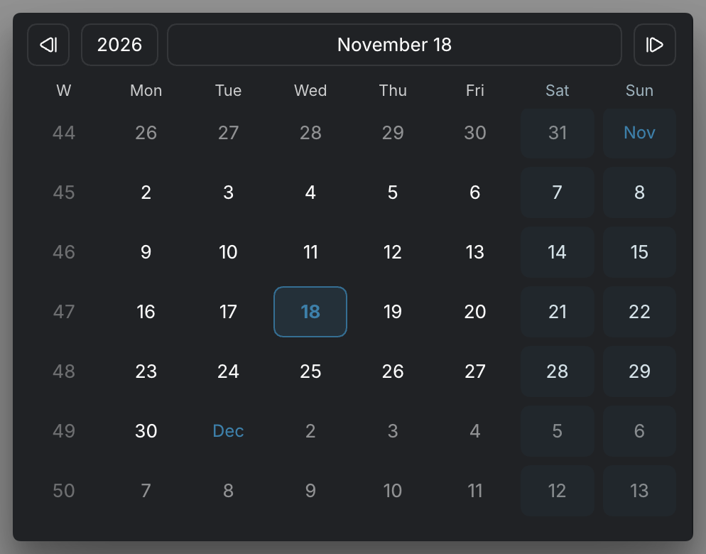

# Mini Calendar

Mini Calendar is a compact Obsidian sidebar for navigating dates and opening daily and weekly notes. It keeps its own date selection when you move around the main [[DOCS-028 Calendar overview|Operon Calendar]].

> **MEDIA-DOCS-155-1:** Mini Calendar in the left sidebar in Continuous weeks mode, with today's week centered and week numbers visible.

## Open the sidebar

Run **Operon: Open mini calendar** from the command palette. A new panel opens in the left sidebar on today. Running the command again brings the existing panel forward on whichever side it occupies, at the date you were viewing.

## Browse dates

Open **Settings → Operon → Views → Calendar → Mini Calendar** and choose a **View mode**.

- **Continuous weeks** is the default. Scroll or swipe through weeks beneath the fixed day headings. The visible range grows with the panel. Small month labels mark the first day of each month, and the current month and centered week stay bright while other days use a softer tone.
- **Month** shows a fixed monthly grid. Use the previous and next buttons to browse months.

In either mode, select the **year** to open the year and month picker. Select the **date** beside it to return to today. In Continuous weeks, this centers today's week in the panel. Date navigation stays in the calendar until you select a day or a week number to open its note.

The grid follows **Week start**. To show or hide the week-number column, use **Calendar sidebar week numbers** under **Settings → Operon → Views → Calendar → Calendar Sidebar Settings**.

## Open a daily or weekly note

| Select | Opens | Settings used |
| --- | --- | --- |
| A day | The Daily Note for that date | Operon's Daily Notes settings when **Manage daily notes with Operon** is on. Otherwise, the enabled Obsidian **Daily Notes** core plugin. |
| A week number | The Weekly Note for that row, anchored to its ISO Monday | Operon's Weekly Notes settings. **Manage weekly notes with Operon** must be on. |

If the note is missing, Operon creates it using the applicable format, folder, and template. The configured **Create daily notes as an Operon task** or **Create weekly notes as an Operon task** preference applies to newly created notes. If the required note settings are unavailable, Mini Calendar shows a notice. See [[DOCS-137 Daily and Weekly Notes#Open a note from Mini Calendar|Daily and Weekly Notes]] for setup and how this differs from the palette's **Create daily note** command.

## Choose what opens on desktop

Under **Settings → Operon → Views → Calendar → Mini Calendar → Click behavior**, choose:

| Option | Opens |
| --- | --- |
| **Source File Only** | The note in a Lightbox. |
| **Source File + Task / Property Editor** | The note alongside its matching editor. This is the default. |
| **Task / Property Editor Only** | The matching editor by itself. |

See [[DOCS-151 Lightbox|Lightbox]] for the desktop source and editor controls.

File Tasks use [[DOCS-021 Task Editor|Task Editor]]. Regular Markdown notes use [[DOCS-154 Property Editor|Property Editor]]. If Operon cannot verify which editor to use, it opens the source Lightbox and shows a notice. On phones and tablets running Obsidian Mobile, tapping a date or week number opens the note in the normal Obsidian file view.

## Related

- [[DOCS-001 Operon Docs MOC|Operon Docs]]
- [[DOCS-028 Calendar overview|Calendar overview]]
- [[DOCS-060 Calendar layout toolbar and sidebar|Calendar layout: toolbar and sidebar]]
- [[DOCS-096 Mobile Calendar|Mobile Calendar]]
- [[DOCS-137 Daily and Weekly Notes|Daily and Weekly Notes]]
