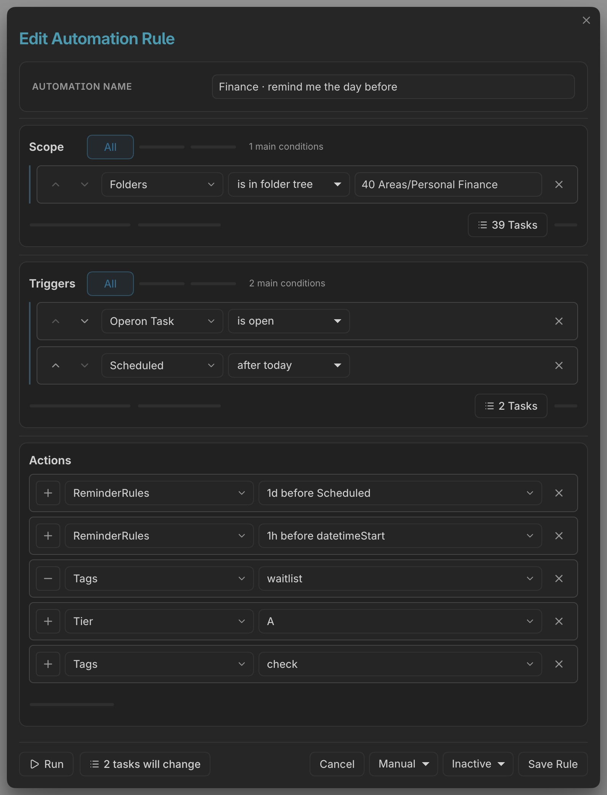
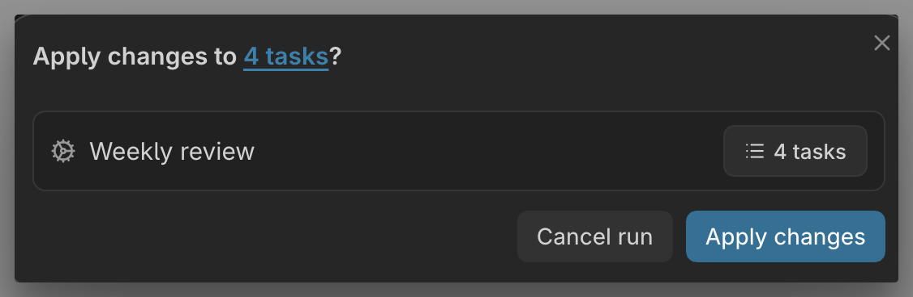
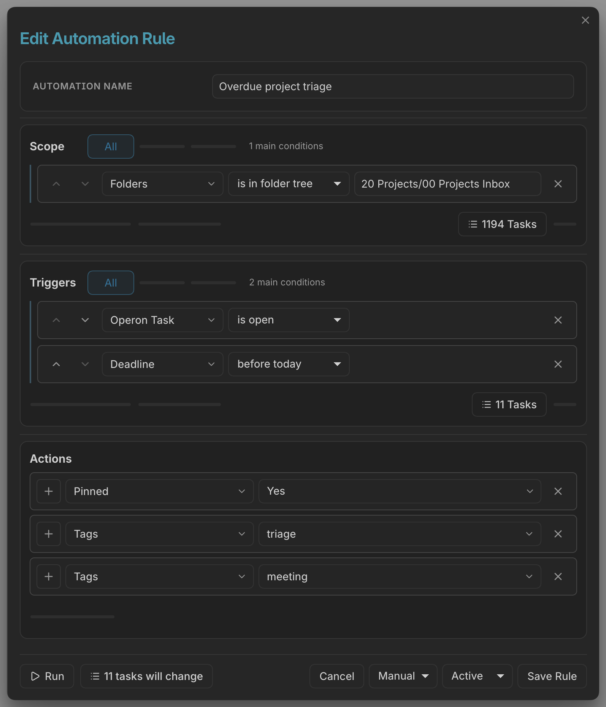

# Automations

Most projects have a few updates you make over and over. You might tag the work scheduled for today, assign a reviewer, or give a new request a due date. In Operon, you can describe that work once as a rule. **Scope** chooses where to look, **Triggers** narrow that set to the tasks you want, and **Actions** describe what to change.

You decide when to apply those changes. Click a **task count** to inspect the list. Click **Run** to apply the actions once. Save the rule as **Auto · Active** if you want Operon to apply it as tasks qualify.

## Build your first rule

1. Open **Settings → Operon → Tasks → Automations**. Under **Automation Rules**, choose **Add Rule** and name it **Weekly review**.
2. In **Scope**, choose **Folders → is in folder tree → Projects**. This includes tasks in the folder and its subfolders.
3. In **Triggers**, choose **Scheduled → is today**. Of the tasks in scope, only those scheduled for the current local day qualify.
4. In **Actions**, choose **Add Action** and set the row to **+ Tags → review**. Leave the new rule **Manual** and **Inactive** while you inspect the counters.

Scope and Triggers both use the [[DOCS-073 Filter conditions and operators|filter conditions]]. Within either section, **All** requires every condition in the group to match, **Any** requires at least one, and **None** excludes tasks matching any condition in that group.

> **MEDIA-DOCS-156-1:** The Finance rule in the editor, showing Scope, Triggers, the tag action, and the Run button beside the count of tasks that will change.

## Read the three counters

Suppose the Projects folder contains 12 tasks. Five are scheduled for today, and two of those already have the `review` tag.

| Counter | What you can inspect |
|---|---|
| **Scope · 12 Tasks** | All 12 tasks in the Projects folder tree. |
| **Triggers · 5 Tasks** | The five tasks in scope scheduled for today, including the two already tagged. |
| **3 tasks will change** beside **Run** | The three tasks that will gain the tag. A task counts once even if several actions change it. |

Click any counter to open its list. The editor previews group tasks by **Last Modified**, with higher priorities first within each day. Subtasks start collapsed. You can open a task’s editor from the list, then return to the rule. The previews update as you change the draft. A parent whose modification time updates because its child changed adds nothing to the Actions count unless an action also changes that parent directly.

## Run a rule once

**Run applies the current actions to the matching tasks.** In the example above, pressing Run adds `review` to three tasks once any required confirmation is accepted. To inspect those three tasks before deciding, click **3 tasks will change** beside the button. Opening that list applies nothing.

Use **Manual** for routines you want to start yourself, such as preparing a review queue before a meeting. You can also use Run for a one-off change without saving a rule. The editor uses the conditions and actions on screen when you click Run, including edits you have not saved. For example, you can change the tag from `review` to `meeting`, run it once, then close the editor. The tasks keep `meeting` and the saved rule still says `review`.

**Inactive** pauses automatic execution. You can explicitly run an inactive rule, including an **Auto · Inactive** rule, and it stays inactive afterward. This lets you use a paused rule for one batch without turning it back on. A one-off run still requires valid conditions and actions and follows your current **Ask before applying changes** preference.

## Save a rule for later or let it run automatically

- **Manual** — Choose **Save Rule** to keep the rule for your next review. Saving a manual rule stores its definition. Use Run when you want to update the tasks.
- **Auto · Inactive** — Save a rule in this state to keep it available on demand while automatic runs are paused.
- **Auto · Active** — Saving a new rule in this state, activating it, or saving a change to its conditions or actions starts an evaluation against the current tasks. Editing only the rule name leaves the tasks alone.

If you run the original draft and then save it as **Auto · Active**, Operon checks the tasks as they are now. All five matching tasks already carry `review`. There is nothing more to write or confirm.

## Open or run a saved rule from the command palette

Every saved rule adds two commands to Obsidian’s **Command palette**. Search for the rule name to find them. For a rule named **Weekly review**, the choices are:

| Command | When to use it |
|---|---|
| **Operon: Open automation › Weekly review** | Open the rule editor to inspect the conditions, preview the task counts, or edit the rule. |
| **Operon: Run automation › Weekly review** | Apply the saved rule once without opening the editor. The command uses the saved conditions and actions, even if an open editor has unsaved changes. It works in either mode and either activation state. |

Each command has its own vault-specific URI. In **Settings → Operon → Core → General → URI Finder**, search for the rule name, select **Open automation** or **Run automation**, and click the copy icon. A link follows the saved rule’s ID, so renaming that rule keeps its links working. See [[DOCS-157 URI Finder|URI Finder]] for example addresses.

> [!tip] Run your review from outside Obsidian
> In URI Finder, copy **Run automation › Weekly review**. In Apple Shortcuts, paste it into an **Open URLs** action. Trigger the shortcut before your weekly meeting. Obsidian handles the link in the specified vault, and Operon runs the saved rule with your usual confirmation preference. If you prefer to inspect the task list first, use the **Open automation** link in the shortcut and click the Actions count in the editor.

## Automatic runs and confirmation

A relevant edit to an in-scope task can trigger an **Auto · Active** rule. When it runs, Operon considers all current matches. For **Weekly review**, the **is today** condition also changes meaning at midnight. Operon checks the current local day when the day changes or Obsidian reopens. A relative date used only as an action value, such as **Scheduled → Tomorrow**, is calculated when the rule runs. It does not schedule a daily run by itself.

In **Scope** or **Triggers**, **Scheduled → this week** follows your **Week start** setting. **Scheduled → week is → 12** matches tasks scheduled in W12 of any year. Entering W12 alone does not trigger an automatic run. See [[DOCS-073 Filter conditions and operators#Filter by week|Filter by week]] for examples of combining or excluding weeks.

Under **Ask before applying changes**, choose **Always ask** (the default), a numeric limit, or **No limit**. The same preference applies to explicit and automatic runs. A numeric limit prompts only **above** the chosen number of distinct tasks. With a limit of **5**, the three changes in the example proceed without a prompt. Five changes also proceed. Six require confirmation.

In a confirmation, click the **total in the heading** to inspect all distinct tasks that will change, or the **count beside a rule** to inspect just its targets. A task affected by two rules can appear in both lists and still count once in the total. These previews are read-only. When more than four rules are listed, use the page controls to see the rest.

For an explicit run, **Cancel run** skips the changes and keeps the saved rule’s state. For an automatic run, **Cancel and deactivate rule** (or **rules**) skips the changes and switches the listed rules to Inactive.

> **MEDIA-DOCS-156-2:** The Weekly review confirmation, showing the total, the rule’s task count, and the Cancel run and Apply changes buttons.

## Rules you can use in your vault

These recipes adapt common review handoffs, due-date defaults, and overdue triage to Operon. Pick folder names, statuses, people, and priorities from your own vault. The triggers below describe a task’s **current state**. When enabling an Auto rule, inspect the Actions count to see which existing tasks qualify too. [ClickUp’s automation examples](https://clickup.com/blog/automation-examples/)

### Hand off editorial work to a reviewer

- **Scope** — Choose the folder tree containing your editorial work.
- **Triggers** — Select the **Status** your pipeline uses for work awaiting review, for example **In Review**.
- **Actions** — Add the reviewer to the task’s people field and add the tag `needs-review`.
- **Mode** — Save as **Auto · Active**. An article in review now appears in a filter for that reviewer. Other people already on the task stay assigned.

### Give new requests a first deadline

- **Scope** — Choose the folder tree where you capture incoming requests.
- **Triggers** — Use **All** with **Created → is today** and **Due → has no value**.
- **Actions** — Set **+ Due** and select **3 days from now** from the date suggestions.
- **Mode** — Save as **Auto · Active**. A request created on Monday without a deadline gets Thursday as its due date. A request that already has a deadline keeps it. Once Operon fills in Due, that request no longer matches the empty-date condition.

### Bring overdue work into a triage meeting

- **Scope** — Choose the project folder you review in the meeting.
- **Triggers** — Use **All** with **Due → before today** and **Operon Task → is open**.
- **Actions** — Set **+ Pinned → Yes** and add the tag `triage`.
- **Mode** — Save as **Manual**. At the start of the meeting, use its Run command to bring overdue work into the Pinned Dock. Tasks due today and completed tasks stay out of this batch. Running it again skips tasks that already have both the pin and the tag.

> **MEDIA-DOCS-156-3:** The overdue triage rule with both conditions visible (open and due before today) and two actions to pin the tasks and add the triage tag.

## Actions by field

Click the **+** or **−** at the start of an action row to switch the operation. For a single value, **+** sets it and **−** clears a match. For a list, each row adds or removes one member. An already present addition or an absent removal produces no change for that row.

| Field | + | − | Example |
|---|---|---|---|
| Priority, Tier, Notes, custom text or number | Set the selected value, replacing any previous value. | Clear the field if it matches. | **− Priority → High** leaves a Medium priority in place. |
| Pinned | Set the chosen Yes/No state. | Clear a matching pin. | **− Pinned → Yes** unpins a pinned task. |
| Tags | Add one tag. | Remove that tag. | **+ Tags → review** keeps every other tag. |
| Custom lists | Add the selected member with its value type. | Remove that member with the same type. | In a YAML list, the number `2` and the text `"2"` are distinct. The text `"A; B"` is one member. Frequently used suggestions appear first. Enter selects the highlighted suggestion. |
| Blocking / Blocked By | Link the task to the selected task. | Remove the selected dependency. | Search by name or ID. The row shows the task name and the rule stores its ID. Operon keeps the reciprocal link on the other task in sync. |
| Task Type / Task Image | Set the chosen type or image. | Clear it if it matches. | **− Task Image → cover.png** leaves a different cover in place. |
| Task Gallery | Add one chosen image. | Remove that image. | Removing `cover.png` keeps the rest of the gallery. |
| Date / Date & time | Set the fixed or calculated value. | Clear the field if it matches that value for this run. | **Tomorrow · 14:45** (**2:45 PM** in 12-hour format) always uses the next local day at that time. Picking a calendar day or typing a full date fixes the day. |
| ReminderRules | Add one rule for any of the five reference dates. | Remove the matching rule. | Add a reminder for 30 minutes before the timed start, even while the start is empty. It can resolve once the task has a start time. |
| ReminderDatetimes | Add one reminder at the fixed or calculated local date and time. | Remove the reminder at that same date and time. | **− Tomorrow · 09:30** removes only the reminder for tomorrow at 09:30 as calculated on the run day. |
| Repeat | Set the chosen recurrence. Each newly recurring task gets its own series. | Clear an equivalent recurrence, preserving its series ID and reference date. | Weekly rules with the same weekdays match even if the weekdays were entered in a different order. If the rule differs, it stays in place and a Scheduled change still uses the applicable reference date to calculate a count-based end date. |

## Related

- [[DOCS-001 Operon Docs MOC|Operon Docs]]
- [[DOCS-073 Filter conditions and operators|Filter conditions and operators]]
- [[DOCS-063 Date and time picker|Date and time picker]]
- [[DOCS-117 Reminder rules|Reminder rules]]
- [[DOCS-064 Recurrence picker|Recurrence picker]]
- [[DOCS-157 URI Finder|URI Finder]]
