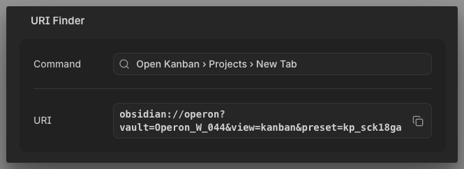

# URI Finder

URI Finder gives you a URI (Uniform Resource Identifier) for an Operon command in a specific vault. You can use that link in a dashboard note or a desktop shortcut. For example, a link to your **Books** Kanban board opens that saved board in a new tab.

## Copy a command link

1. In **Settings → Operon → Core → General**, find **URI Finder**.
2. Click the empty **Command** field to browse, or type part of the command or preset name. For the Books board, search for `kanban books`.
3. Select **Open Kanban › Books › New Tab**. Selecting it displays the address in the **URI** field.
4. Click the copy icon inside the URI field. In a Markdown note, use the copied address as the destination of a link.

> **MEDIA-DOCS-157-1:** URI Finder in Settings with the Projects command selected. Use the copy icon beside its URI.



For example, a dashboard link might look like this:

```md
[Open my books board](obsidian://operon?vault=My%20Vault&view=kanban&preset=kp_c3d4e5f)
```

## Choose what the link opens

| Choose in URI Finder | What happens when you follow the link |
|---|---|
| **Open Calendar › Default › New Tab** | Opens Calendar with its normal default behavior. Filter, Kanban, and Table have the same default command. |
| **Open Kanban › Books › New Tab** | Opens the saved Books preset. Named Filter, Calendar, and Table presets work the same way. |
| **Open Table › Projects › Lightbox** | Opens the file-backed Projects table over your current view on desktop. If you follow the link where Lightbox is unavailable and the table still exists, Operon offers to open it in a new tab. |
| **Open automation › Weekly review** | Opens the editor for that saved rule. |
| **Run automation › Weekly review** | Runs the saved rule once, even if it is inactive or set to Auto. Your current confirmation settings apply. |

Each address includes the vault name. A named preset or rule also has a stable ID, so its link keeps working when you rename it. If you delete the target, Operon reports that it could not find it. A **Default** link follows the default opening behavior at the time you use it.

## Example addresses

These examples use a vault named **My Vault** and sample IDs. Copy the link from your own URI Finder to use your vault and saved items.

| Command | URI |
|---|---|
| Open the default Calendar | `obsidian://operon?vault=My%20Vault&view=calendar` |
| Open the Projects table in Lightbox | `obsidian://operon?vault=My%20Vault&view=table&preset=tp_a1b2c3d&paneType=lightbox` |
| Edit the Weekly review rule | `obsidian://operon?vault=My%20Vault&view=automation&rule=ar_a1b2c3d` |
| Run the Weekly review rule | `obsidian://operon?vault=My%20Vault&view=automation&rule=ar_a1b2c3d&run=true` |
| Create New Operon Task | `obsidian://operon?vault=My%20Vault&command=open-task-creator` |

> [!tip] Open Task Creator from Raycast
> In URI Finder, select **Create New Operon Task** and copy its URI. In Raycast, run **Create Quicklink**, name it `Capture a task`, paste the URI as the link, and save. Run `Capture a task` from Raycast to open Task Creator in the vault named in the URI. [Raycast Quicklinks guide](https://manual.raycast.com/quicklinks)

> [!tip] Start or stop the timer from Raycast
> In URI Finder, copy the URI for **Start/stop timer** and save it as a Raycast Quicklink named `Toggle timer`. Run it to stop the active timer in that vault, even while another app is in front. If the timer is idle, the same Quicklink starts an unassigned timer. See [[DOCS-034 Time tracking#Start and stop|Start and stop]].

## Related

- [[DOCS-022 Command palette reference|Command palette reference]]
- [[DOCS-151 Lightbox|Lightbox]]
